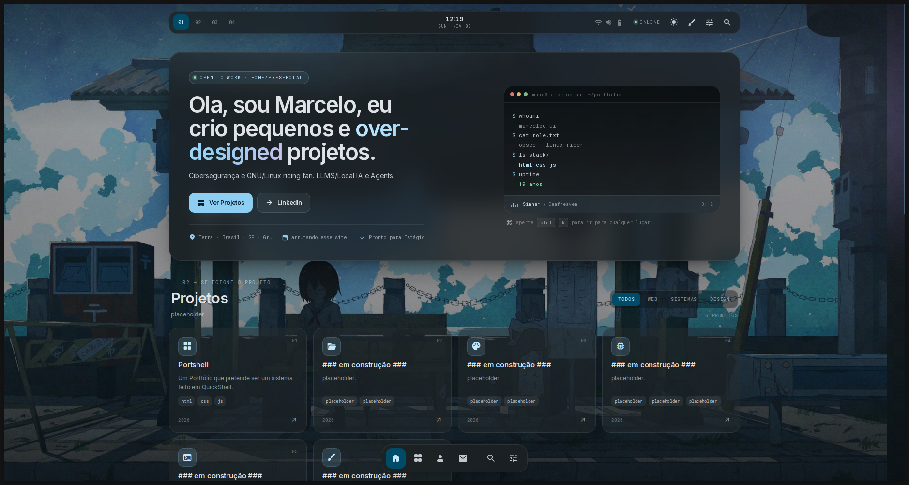
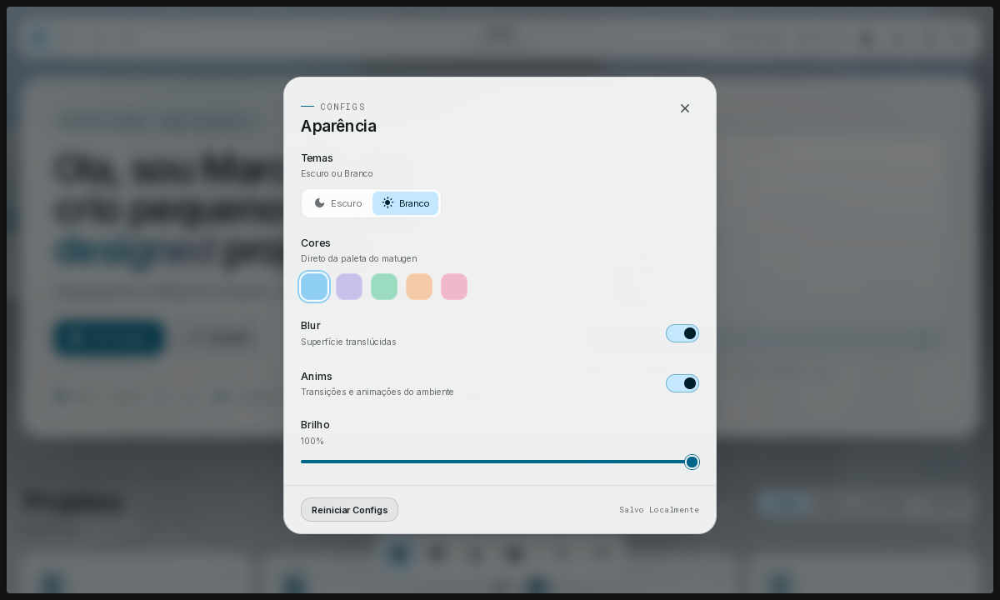
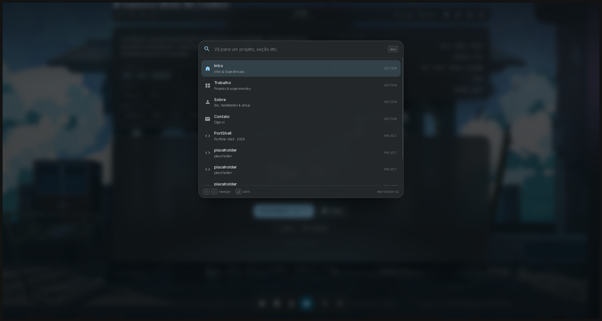

# PORTSHELL

Pequeno projeto pessoal meu para um portfólio inspirado em [Quickshell](https://quickshell.org) e [Hyprland](https://hypr.land), porém desenvolvido em HTML e CSS puro.

> Como eu disse, é um **projeto pessoal**, então, quando eu terminá-lo, não pretendo atualizá-lo com tanta frequência.

## Algumas fotos do site

  
  
  

## Inspirações

| Links | Conteúdo |
|---|---|
| [Hyprland](https://hypr.land) | Usado de inspiração para o aliamento de cada bloco |
| [QuickShell](https://quickshell.org) | Usado para ter uma base de como o site deve ser |
| [Rofi](https://github.com/davatorium/rofi) | AppLauncher, Usei a base dele para fazer o meu próprio |
| [LDMS](https://duxlabs.dev/) | Mais uma grande Inspiração para o site |
| [Matugen](https://github.com/InioX/matugen) | Usado para cores |
| [II](https://ii.clsty.link/en/) | Por fim, Minha maior inspiração para esse projeto |

> Feito com amor e carinho por [marceloo-ui](https://github.com/marceloo-ui)
